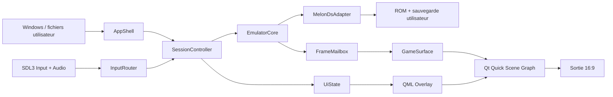

# HeartGold PC Remastered — Design du prototype architectural

**Statut :** proposition à valider avant le plan d’implémentation  
**Date :** 22 septembre 2026  
**Portée :** prototype vertical du menu principal mono-écran  

## 1. Intention

HeartGold PC Remastered est une application PC qui exécute une copie de Pokémon HeartGold fournie par l’utilisateur et présente le jeu comme une expérience PC mono-écran. Le jeu original demeure responsable des cartes, scripts, combats et sauvegardes. L’application prend en charge la fenêtre, le rendu, les entrées et une couche d’interfaces PC qui remplacera progressivement les usages tactiles visibles.

Le premier livrable doit prouver que cette architecture est viable. Il affiche le jeu en arrière-plan, ne montre jamais l’écran inférieur de la Nintendo DS, ouvre un menu principal inspiré de la logique de Pokémon Diamant Étincelant et Perle Scintillante, et se contrôle intégralement au clavier ou à la manette.

Le projet est un lanceur et une couche d’expérience. Il ne contient ni ROM, ni BIOS, ni firmware Nintendo, ni sprite, texture, police, musique, son ou autre ressource extraite d’un jeu Pokémon.

## 2. Résultat attendu du prototype

Une personne possédant sa propre ROM `.nds` lance l’application sous Windows 11 x64, choisit son fichier, puis joue dans une fenêtre ou en plein écran. L’image supérieure du jeu est centrée sans déformation dans une composition 16:9. L’écran inférieur continue d’exister dans l’émulation lorsque le jeu en a besoin, mais il n’est jamais affiché.

Une commande dédiée ouvre le menu PC. L’émulation se met alors en pause et l’image du jeu devient un fond assombri ou légèrement flouté. Le joueur déplace le focus entre de grandes tuiles avec les flèches, WASD, le D-pad ou le stick gauche. Les indications de touches s’adaptent au dernier périphérique utilisé. `Reprendre` ferme le menu. `Options` permet de changer le mode d’affichage, le filtre d’image et le volume. Les tuiles des futures interfaces Pokémon sont visibles, mais portent un état indisponible explicite tant qu’elles ne sont pas reliées au jeu.

Le prototype est réussi s’il démontre le chemin complet suivant sans exposer l’interface DS : ROM utilisateur → émulation stable → image supérieure → composition 16:9 → overlay PC → navigation clavier/manette → retour au jeu.

## 3. Périmètre

### Inclus

- sélection et validation locale d’une ROM `.nds` fournie par l’utilisateur ;
- démarrage, pause, reprise et arrêt propres d’une session d’émulation ;
- rendu de l’écran supérieur uniquement ;
- affichage fenêtré, plein écran sans bordure et mise à l’échelle nette jusqu’à 3840 × 2160 ;
- composition 16:9 sans étirer ni rogner l’image 4:3 du jeu ;
- menu principal PC, navigation au clavier et à la manette, indications de commandes contextuelles ;
- branchement et débranchement d’une manette pendant l’exécution ;
- son du jeu, réglage du volume et silence en arrière-plan selon l’option choisie ;
- conservation des sauvegardes natives du jeu dans un dossier utilisateur séparé de la ROM ;
- journal local utile au diagnostic, sans contenu de la ROM ni données de sauvegarde.

### Hors périmètre du prototype

- remplacement fonctionnel de l’équipe, du sac, du Pokédex, du Pokégear ou des combats ;
- extension native du champ de vision du jeu en 16:9 ;
- textures HD, nouveaux sprites, nouvelles cartes ou modifications de scénario ;
- fonctions réseau, multijoueur ou services en ligne ;
- états de sauvegarde instantanés présentés comme sauvegardes normales ;
- prise en charge complète de toutes les versions, langues et révisions de HeartGold ;
- Linux, macOS, Steam Deck, installateur public et mise à jour automatique ;
- distribution de fichiers protégés ou téléchargement automatique de ceux-ci.

## 4. Principes de produit

1. **Le joueur ne voit qu’un jeu PC mono-écran.** Aucun basculement libre vers une disposition DS et aucune souris simulant directement le stylet ne font partie de l’expérience normale.
2. **Le jeu original reste l’autorité.** Le prototype ne duplique pas les règles, les combats, les scripts ou le format de sauvegarde.
3. **Les remplacements sont progressifs.** Une interface PC n’est activée que lorsqu’elle est fonctionnelle et vérifiée. Avant cela, elle apparaît indisponible plutôt que de simuler une fonction incomplète.
4. **Le 16:9 est une composition.** L’image 256 × 192 du jeu garde son ratio 4:3. Les marges peuvent recevoir une couleur, un motif original ou une version floutée de l’image, mais le monde n’est ni étiré ni artificiellement élargi.
5. **Tout contenu distribué est original ou correctement licencié.** L’inspiration porte sur la hiérarchie, la lisibilité et les interactions de l’interface Switch, pas sur la copie de ses ressources.

## 5. Approches étudiées

### A. Application native avec cœur d’émulation intégré — recommandée

Le projet contrôle directement le cycle de l’émulateur, les images, le son et les entrées à travers une interface interne. Le cœur melonDS est compilé comme dépendance épinglée et masqué derrière un adaptateur.

**Avantages :** synchronisation fiable, une seule fenêtre, latence réduite, contrôle précis de l’écran inférieur, intégration propre des overlays et chemin crédible vers les futures interfaces connectées à l’état du jeu.

**Coûts :** intégration C++ plus exigeante, maintenance lors des mises à jour du cœur et obligation de respecter la GPL de melonDS pour l’application distribuée.

### B. Émulateur lancé dans un processus séparé

L’application PC pilote un exécutable d’émulation et récupère l’image par capture ou mémoire partagée.

**Avantages :** isolation des pannes et mise à jour indépendante de l’émulateur.

**Coûts :** focus de fenêtre fragile, capture et synchronisation plus complexes, latence supplémentaire, gestion audio difficile et accès limité à l’état du jeu. Cette approche ne convient pas à la trajectoire de remplacement progressif des interfaces.

### C. Modification directe de l’interface officielle de melonDS

Le projet part du frontend existant de melonDS et ajoute le menu PC dans cette base.

**Avantages :** démarrage rapide pour afficher une ROM et réutilisation de code éprouvé.

**Coûts :** forte dépendance à la structure du frontend amont, séparation produit moins claire et évolution de l’interface plus difficile. Cette voie reste utile comme référence technique, mais pas comme architecture du produit.

### Décision proposée

Retenir l’approche A. Le coût initial est supérieur, mais c’est la seule option qui traite le prototype comme le premier morceau du produit final plutôt que comme une démonstration jetable.

## 6. Pile technique proposée

- **Langage :** C++20.
- **Build :** CMake avec dépendances verrouillées par version ou commit reproductible.
- **Cœur Nintendo DS :** melonDS encapsulé derrière `EmulatorCore`.
- **Fenêtre et interface :** Qt 6 Quick/QML pour la composition GPU, les animations, les tuiles, le texte et le focus.
- **Manettes et audio :** SDL3, afin d’obtenir des correspondances de manettes cohérentes, le branchement à chaud et une sortie audio portable.
- **Tests :** Qt Test pour les unités C++, Qt Quick Test pour la navigation QML, et un exécutable de test avec un faux cœur d’émulation.
- **Plateforme initiale :** Windows 11 x64.
- **Licence du projet distribué :** GPL-3.0-or-later, cohérente avec melonDS. Les bibliothèques et leurs notices restent documentées séparément.

Qt Quick est retenu pour obtenir une interface animée et redimensionnable sans construire un moteur d’UI. SDL3 reste limité aux domaines où sa couche multiplateforme est utile. L’application ne dépend pas directement des classes internes de melonDS en dehors de l’adaptateur.

## 7. Architecture

### `AppShell`

Possède la fenêtre, le plein écran, les chemins de configuration, le démarrage et l’arrêt global. Il ne connaît ni les adresses mémoire du jeu ni les détails du menu.

### `SessionController`

Orchestre les états `NoRom`, `Loading`, `Playing`, `MenuOpen`, `Stopping` et `Error`. Il est la seule autorité qui peut mettre le cœur en pause, capturer les entrées du joueur pour l’overlay ou rendre le contrôle au jeu.

### `EmulatorCore`

Contrat stable avec les opérations suivantes : charger une ROM, démarrer, suspendre, reprendre, arrêter, envoyer l’état des boutons DS, recevoir la dernière image supérieure et produire l’audio. L’écran inférieur peut être calculé par le cœur, mais aucun consommateur d’interface publique ne le reçoit dans le prototype.

### `MelonDsAdapter`

Seul module autorisé à inclure les en-têtes du cœur melonDS. Il transforme les types melonDS en types appartenant au projet. Une mise à jour du cœur ne doit pas obliger à modifier l’UI, le routeur d’entrées ou le contrôleur de session.

### `FrameMailbox` et `GameSurface`

`FrameMailbox` transfère la dernière image complète disponible sans bloquer la boucle d’émulation. `GameSurface` importe ou téléverse cette image dans le graphe de scène Qt. Une image ancienne peut être réaffichée pendant une trame ; l’UI ne doit jamais attendre le cœur.

### `InputRouter`

Convertit clavier et manettes en actions sémantiques : `MoveUp`, `MoveDown`, `MoveLeft`, `MoveRight`, `Confirm`, `Back`, `OpenMenu`, `ToggleFullscreen`. Selon l’état de session, il envoie ces actions au menu ou les traduit en boutons DS. Une même pression ne peut jamais atteindre les deux cibles.

### `UiState` et overlays QML

`UiState` expose à QML uniquement des propriétés et commandes de présentation. Le QML ne lit pas la ROM, ne manipule pas l’émulateur et ne contient aucune logique de compatibilité liée à HeartGold.

## 8. Flux d’exécution

1. L’application affiche un écran d’accueil original avec `Choisir une ROM`.
2. Le validateur lit l’en-tête NDS, confirme qu’il s’agit d’une édition de HeartGold, calcule un SHA-256 local et refuse un fichier illisible, incohérent ou appartenant à un autre jeu. Le hash sert au diagnostic de compatibilité ; le fichier n’est ni copié dans le dépôt ni envoyé sur un réseau.
3. `SessionController` prépare un dossier de sauvegarde dérivé d’un identifiant stable, puis charge le cœur.
4. Le cœur tourne sur un thread dédié. Il publie la dernière image supérieure et des blocs audio bornés.
5. Qt compose l’image du jeu, le fond 16:9 et les overlays à la fréquence de la fenêtre.
6. Quand `OpenMenu` est pressé, le contrôleur suspend le cœur après une limite de trame, neutralise les boutons DS encore enfoncés, puis affiche l’overlay.
7. Quand le menu se ferme, les entrées sont remises à zéro avant la reprise afin d’éviter un déplacement ou une validation fantôme.
8. Lors de la fermeture, le contrôleur demande un arrêt propre et attend la confirmation du cœur avant de libérer l’audio et la fenêtre.

## 9. Présentation 16:9 et mise à l’échelle

Le canevas logique de l’interface est 1920 × 1080. Toutes les positions QML sont adaptatives et respectent une zone sûre de 5 % sur les quatre côtés. Les textes et tuiles suivent le facteur d’échelle du système.

L’image du jeu utilise `contain` avec un ratio fixe de 4:3. À 1920 × 1080, elle occupe au maximum 1440 × 1080 ; à 3840 × 2160, 2880 × 2160. Les bandes latérales font partie du décor de l’application. Deux filtres sont prévus : `Net` par défaut, basé sur un agrandissement entier quand il est possible, et `Lissé`. Aucun filtre ne modifie la logique de rendu du jeu.

Lorsque le menu est ouvert, l’image du jeu reste visible derrière une couche sombre. Un flou léger peut être activé si son coût GPU reste sous le budget de trame ; l’assombrissement seul constitue le comportement de repli.

## 10. Menu du prototype

Le menu reprend une grille de grandes tuiles colorées, avec le focus très visible et une barre de commandes en bas. La structure proposée est :

- rangée 1 : `Pokédex`, `Équipe`, `Sac`, `Dresseur` ;
- rangée 2 : `Pokégear`, `Carte`, `Options`, `Reprendre` ;
- zone secondaire : objectif actuel absent du prototype, car le jeu ne fournit pas encore une source fiable ;
- barre de commandes : `Valider`, `Retour`, `Reprendre`, avec glyphes adaptés au périphérique.

`Pokédex`, `Équipe`, `Sac`, `Dresseur`, `Pokégear` et `Carte` sont visibles mais désactivés dans cette première tranche. Une activation produit une indication courte et non bloquante : `Disponible dans une prochaine étape`. `Options` et `Reprendre` sont fonctionnels.

### Correspondance par défaut

| Action | Manette standard | Clavier |
|---|---|---|
| Se déplacer | D-pad ou stick gauche | Flèches ou WASD |
| Valider | Bouton Sud | Entrée ou E |
| Retour | Bouton Est | Échap |
| Ouvrir / fermer le menu | Start / Menu | Tab |
| Basculer plein écran | Sans raccourci imposé | F11 |

Les libellés montrent `A/B` pour une manette de type Xbox et les symboles adaptés lorsqu’un type de manette fiable est détecté. À défaut, ils utilisent `Bouton Sud` et `Bouton Est`.

## 11. ROM, firmware et sauvegardes

- La ROM reste à son emplacement d’origine et n’est jamais modifiée.
- L’application mémorise son chemin seulement si l’utilisateur active `Rouvrir le dernier jeu`.
- Les sauvegardes natives sont stockées sous `%LOCALAPPDATA%/HeartGoldPCRemastered/saves/<game-id>/` avec écriture atomique lorsque le cœur le permet.
- Un fichier de sauvegarde existant n’est jamais écrasé sans copie de secours locale datée.
- Les BIOS ou firmwares requis par un mode d’émulation sont sélectionnés par l’utilisateur et traités comme des fichiers privés. Ils ne sont pas inclus dans le paquet.
- Le prototype accepte les éditions HeartGold dont l’en-tête NDS est valide. Son menu générique n’accède pas aux structures internes du jeu et n’exige donc pas encore de révision précise. Les futures lectures de données seront activées uniquement par profils de compatibilité identifiés par hash.

## 12. Stratégie future de remplacement des interfaces

Chaque interface PC future dépendra d’un `GameDataProvider` en lecture et d’un `GameCommandGateway` limité aux actions sûres. Les profils de compatibilité associeront une révision vérifiée du jeu à des extracteurs et commandes testés. Le cœur de l’UI ne contiendra aucune adresse mémoire.

L’ordre proposé est :

1. lecture seule de l’équipe et de ses statistiques ;
2. équipe interactive avec changement d’ordre ;
3. sac et utilisation d’objets hors combat ;
4. Pokédex ;
5. Pokégear et carte ;
6. interface de combat.

Une interface ne remplace son équivalent DS qu’après validation de ses états particuliers : équipe vide ou incomplète, œufs, objets sans cible, capacités de terrain, évolutions, combats scénarisés et erreurs de sauvegarde. Si un profil n’est pas reconnu, l’application revient à une expérience compatible plutôt que d’écrire dans une mémoire inconnue. L’écran inférieur reste toutefois masqué ; les parcours qui ne peuvent pas encore être accomplis doivent être signalés comme non pris en charge par cette version.

## 13. Erreurs et récupération

- **ROM invalide :** retour à l’accueil avec une raison compréhensible, sans fermer l’application.
- **Dépendances privées absentes :** écran guidé indiquant précisément le type de fichier attendu, sans lien de téléchargement illicite.
- **Échec du cœur :** arrêt de la session, conservation du journal et retour à l’accueil.
- **Périphérique débranché :** maintien du menu ouvert et bascule immédiate vers le clavier.
- **Échec audio :** poursuite de la session en silence avec avertissement discret.
- **Échec d’écriture de sauvegarde :** pause de la session et message bloquant avant toute nouvelle tentative d’écriture.
- **GPU ou flou indisponible :** composition sans flou ; le rendu du jeu et la navigation restent utilisables.

## 14. Validation et tests

Le projet doit être testable sans ROM commerciale. Un `FakeEmulatorCore` produit une mire animée, une tonalité contrôlée et des compteurs de pause/reprise. Il permet les tests automatisés et les démonstrations du menu sans contenu protégé.

Les tests du prototype couvrent :

- transitions valides et invalides de la machine d’états ;
- exclusion mutuelle entre entrées du jeu et entrées du menu ;
- remise à zéro des boutons lors des pauses et reprises ;
- navigation complète de la grille au clavier et à la manette ;
- changement des glyphes selon le dernier périphérique ;
- redimensionnement de 1280 × 720 à 3840 × 2160 sans étirement du jeu ;
- branchement à chaud et perte d’une manette ;
- ROM invalide, cœur en échec, audio absent et sauvegarde non inscriptible ;
- arrêt propre sous charge ;
- vérification manuelle d’une session HeartGold avec une ROM légalement obtenue, hors automatisation et hors dépôt.

Le budget visé est une interface à 60 images par seconde, sans blocage visible de plus de 50 ms lors de la navigation. L’audio ne doit pas craquer lors de l’ouverture ou de la fermeture du menu. La stabilité du cœur prime sur les effets visuels.

## 15. Risques principaux

| Risque | Effet | Réponse prévue |
|---|---|---|
| Le cœur melonDS n’offre pas une frontière d’intégration assez stable | Retards et maintenance coûteuse | Construire l’adaptateur lors d’un premier jalon technique, épingler la dépendance et interdire sa fuite dans le reste du code |
| Conflit entre la boucle Qt, le thread d’émulation et l’audio SDL | Saccades, blocages ou désynchronisation | Files bornées, aucune attente du cœur côté UI, propriété explicite de chaque thread |
| Les interactions tactiles indispensables apparaissent plus tôt que prévu | Progression bloquée avec l’écran inférieur masqué | Recenser les parcours du début de jeu pendant le prototype et ajouter seulement des commandes de compatibilité ciblées |
| Les versions régionales utilisent des structures mémoire différentes | Corruption ou données fausses | Profils identifiés par hash, lecture seule en premier, écriture désactivée pour toute version inconnue |
| L’interface paraît copiée de la version Switch | Risque juridique et identité faible | Créer formes, palette, icônes, animations et sons originaux tout en conservant le principe de grille et les conventions de navigation |
| Sauvegarde endommagée par un arrêt ou une mise à jour | Perte de progression | Écriture atomique, secours daté, tests de panne et séparation stricte entre ROM et sauvegardes |
| Charge GPU du fond flouté en 4K | Chute de fluidité | Flou facultatif, texture réduite pour l’effet, repli immédiat vers un voile sombre |

## 16. Roadmap réaliste

Les durées ci-dessous supposent une personne développant le projet à temps plein. Elles sont des ordres de grandeur, pas des dates de livraison.

### Jalon 0 — preuve d’intégration, 3 à 5 jours

Compiler une version épinglée de melonDS, démarrer un homebrew de test ou une mire libre, récupérer l’image supérieure, envoyer les entrées et arrêter proprement. Ce jalon confirme ou invalide le choix d’intégration avant d’investir dans l’UI.

### Jalon 1 — socle applicatif, 1 à 2 semaines

Mettre en place la machine d’états, le faux cœur, la fenêtre Qt, l’audio, les réglages, les dossiers utilisateur et les erreurs structurées.

### Jalon 2 — prototype vertical, 2 à 3 semaines

Intégrer le cœur réel, la composition 16:9, le plein écran, le scaling 4K, le routeur clavier/manette, le menu QML, les options et les sauvegardes natives.

### Jalon 3 — durcissement du prototype, 1 à 2 semaines

Tester plusieurs GPU et manettes, les changements de résolution, les arrêts forcés, les fichiers invalides et un parcours de jeu représentatif. Documenter la fourniture des fichiers privés et préparer un paquet de test interne sans contenu protégé.

### Jalon 4 — première interface reliée au jeu, 3 à 6 semaines

Créer un profil de compatibilité pour une révision de référence, lire l’équipe en mode strictement lecture seule, puis livrer l’écran Équipe PC. Ce jalon ouvre un nouveau cycle spec → plan → implémentation.

### Jalons suivants — plusieurs mois

Ajouter les autres interfaces une par une, chacune avec sa propre spec et ses tests de compatibilité. Le sac et les combats sont les plus risqués parce qu’ils modifient directement l’état et comportent de nombreux cas spéciaux.

## 17. Critères d’acceptation du prototype

Le prototype est accepté lorsque tous les points suivants sont vrais :

1. Il démarre sous Windows 11 x64 sans ROM incluse dans le paquet.
2. Il accepte un fichier choisi par l’utilisateur et affiche HeartGold dans une fenêtre unique.
3. L’écran inférieur DS n’apparaît à aucun moment dans l’expérience normale.
4. L’image du jeu conserve son ratio 4:3 en fenêtre et en plein écran de 720p à 4K.
5. Le menu s’ouvre et se ferme sans entrée fantôme dans le jeu.
6. Toute la grille est navigable au clavier et avec une manette branchée avant ou pendant la session.
7. `Options` et `Reprendre` fonctionnent ; les autres tuiles affichent clairement leur indisponibilité.
8. La sauvegarde native reste lisible après fermeture et relance, et une copie de secours protège toute écriture remplacée.
9. Les tests automatisés utilisent le faux cœur et ne nécessitent aucun fichier Nintendo.
10. Le dépôt et le paquet généré ne contiennent aucun contenu extrait de Pokémon ou d’une console Nintendo.

## 18. Décisions validées par l’approbation de cette spec

L’approbation de ce document valide :

- le périmètre limité au menu principal et aux fondations d’émulation ;
- Windows 11 x64 comme première plateforme ;
- C++20, CMake, Qt Quick/QML, SDL3 et un cœur melonDS encapsulé ;
- la distribution du code sous GPL-3.0-or-later ;
- une composition 16:9 qui préserve l’image 4:3 ;
- les six tuiles Pokémon non fonctionnelles mais explicitement désactivées dans le prototype ;
- l’usage d’assets entièrement originaux pour l’application ;
- la roadmap par interfaces successives, avec une nouvelle spec avant chaque sous-système important.

Après validation, l’étape suivante sera un plan d’implémentation détaillé et vérifiable. Aucun code produit, dépendance ou échafaudage ne doit être créé avant l’approbation de la spec puis du plan.

## 19. Références techniques

- melonDS, dépôt et licence GPL-3.0-or-later : <https://github.com/melonDS-emu/melonDS>
- SDL3, gestion de la haute densité : <https://wiki.libsdl.org/SDL3/README-highdpi>
- SDL3, API des manettes : <https://wiki.libsdl.org/SDL3/CategoryGamepad>
- Qt 6, conditions de licence : <https://doc.qt.io/qt-6/licensing.html>
